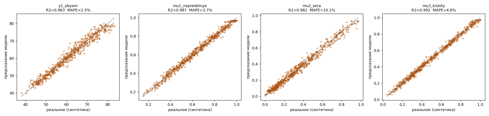
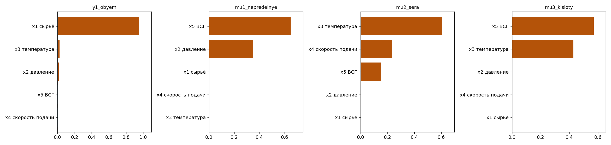
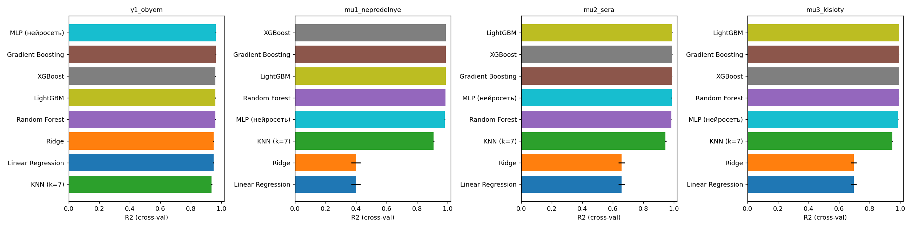

# test_ml_optimize

ML-пайплайн для оптимизации режима реактора гидроочистки Р-1 (установка ЛГ-35-11/300-95).
Модели машинного обучения используются как «чёрный ящик»: по режимным параметрам x1–x5
они предсказывают объём гидрогенизата и показатели качества, а затем по ним ищется режим
с максимальным объёмом при заданном уровне качества.

> ⚠️ Сейчас проект работает на **синтетических данных**: физически мотивированная модель
> (кинетика HDS/гидрирования), откалиброванная по 3 реальным точкам из диссертации.

## Переменные

| Вход | Описание | Диапазон |
|---|---|---|
| `x1_syre` | сырьё, м³/ч | 45–80 |
| `x2_davlenie` | давление, кг/см² | 20–35 |
| `x3_temperatura` | температура, °C | 300–343 |
| `x4_skorost` | объёмная скорость подачи, ч⁻¹ | 0.5–5 |
| `x5_vsg` | ВСГ, H₂/УВ, нм³ | 200–500 |

| Выход | Описание |
|---|---|
| `y1_obyem` | объём гидрогенизата |
| `mu1_nepredelnye` | показатель качества: непредельные |
| `mu2_sera` | показатель качества: сера |
| `mu3_kisloty` | показатель качества: кислоты |

Критерий качества: `Score = 0.35·mu1 + 0.40·mu2 + 0.25·mu3` (веса из диссертации), порог `Score ≥ 0.90`.

## Структура

```
generate_data.py    # 1. генерация синтетического датасета (3000 строк)
train_model.py      # 2. обучение 4 моделей Random Forest (y1, mu1, mu2, mu3)
validate_model.py   # 3. валидация: train/test, 5-fold CV, сверка с реальными точками
optimize.py         # 4. поиск оптимального режима (20 000 случайных комбинаций)
compare_models.py   # сравнение 8 алгоритмов (LR, Ridge, KNN, RF, GB, XGBoost, LightGBM, MLP)
data/               # synthetic_dataset.csv, model_comparison.csv
plots/              # parity_plots, feature_importance, model_comparison
HOW_TO_RUN.md       # подробная инструкция по каждому этапу
```

## Быстрый старт

```bash
pip install numpy pandas scikit-learn matplotlib joblib
# для compare_models.py дополнительно:
pip install xgboost lightgbm

python3 generate_data.py && python3 train_model.py && python3 validate_model.py && python3 optimize.py
```

Обученные модели (`models/*.joblib`, ~20 МБ каждая) не хранятся в репозитории —
они создаются командой `python3 train_model.py`.

## Результаты (Random Forest, тестовая выборка)

| Цель | R² | MAE | MAPE |
|---|---|---|---|
| y1_obyem | 0.963 | 1.556 | 2.55% |
| mu1_nepredelnye | 0.987 | 0.020 | 3.67% |
| mu2_sera | 0.982 | 0.026 | 10.15% |
| mu3_kisloty | 0.993 | 0.017 | 4.63% |





## Переход на реальные данные завода

1. Замените `data/synthetic_dataset.csv` на реальный CSV с теми же именами колонок.
2. Запустите `python3 train_model.py && python3 validate_model.py && python3 optimize.py`
   (`generate_data.py` больше не нужен).
3. В `optimize.py` сузьте `BOUNDS` до диапазонов, реально встречавшихся в исторических данных.
4. В `validate_model.py` замените «Уровень 3» на проверку по отложенным во времени данным
   (процесс — временной ряд, случайное перемешивание не подходит).

Подробности — в [HOW_TO_RUN.md](HOW_TO_RUN.md).
